# Terminal|deepin-terminal|

## Visão Geral

O Terminal é um emulador de terminal com interface simples e elegante que oferece funções diversificadas e poderosas, incluindo suporte a múltiplas janelas, espaços de trabalho, gerenciamento remoto, modo Quake, entre outros. Você pode abrir e fechar o Terminal instantaneamente e de forma fluida, como qualquer janela normal de arquivos, libertando-se de limitações e incômodos ao digitar comandos. Experimente o modo Quake, que permite navegar em outras janelas enquanto digita comandos na mesma tela. Em multitarefas, você pode adicionar abas no terminal para criar mais espaços de trabalho como em um navegador, ou dividir o espaço de trabalho em múltiplas janelas. Também é extremamente fácil enviar e baixar arquivos com o gerenciamento remoto. Funções ainda mais poderosas esperam por você!

 

## Guia

Você pode executar, sair ou criar atalhos para o Terminal.

### Executar o Terminal

1. Clique no ícone do Iniciador  no Dock para abrir a interface do Iniciador.
2. Localize o Terminal  rolando a roda do mouse ou pesquisando por "terminal" no Iniciador e clique nele para executar.
3. Clique com o botão direito em  para: 
 - Selecionar **Enviar para a área de trabalho** para criar um atalho na área de trabalho.
 - Selecionar **Fixar no dock** para fixá-lo no Dock.
 - Selecionar **Adicionar à inicialização** para que o aplicativo seja iniciado automaticamente ao ligar o computador.

>  Notas: Você também pode pressionar **Ctrl** + **Alt** + **T** para abrir o Terminal.

### Sair do Terminal

1. Na interface do Terminal, clique em  para sair.
2. Clique com o botão direito em  no Dock e selecione **Fechar tudo** para sair.
3. Na interface do Terminal, clique em  e selecione **Sair**.

>  Notas: Um aviso será exibido caso ainda existam programas em execução no Terminal para evitar perda de dados.

### Exibir Atalhos

Na interface do Terminal, pressione **Ctrl + Shift + ?** para visualizar os atalhos de teclado. A familiaridade com os atalhos aumentará bastante a sua produtividade.

 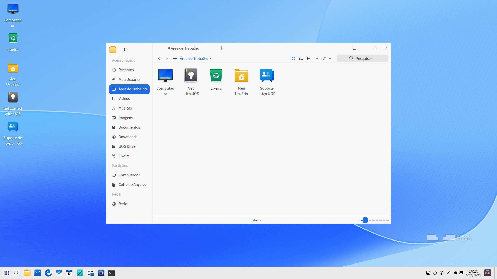

## Operações Básicas

Você pode clicar com o botão direito na interface do Terminal para operações do dia a dia.

 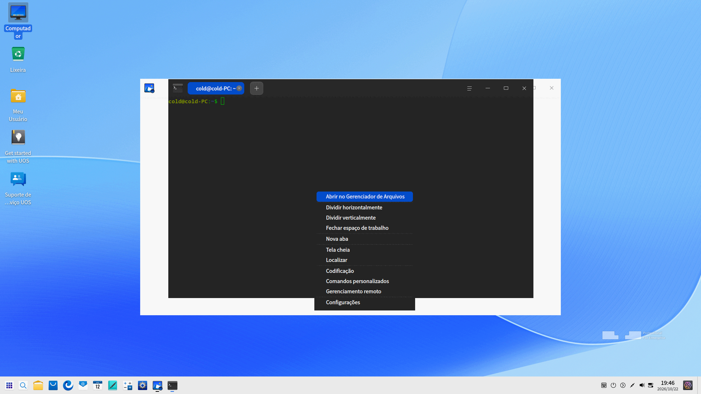

### Localizar

Você pode usar a função **Localizar** para buscar rapidamente conteúdos no terminal.

1. Clique com o botão direito na interface do Terminal para selecionar **Localizar** ou pressione as teclas **Ctrl** + **Alt** + **F** no teclado.
2. Digite a palavra na caixa de pesquisa.
3. Pressione a tecla **Enter** no teclado e os resultados da pesquisa serão destacados.
4. Pressione **Esc** no teclado ou clique em qualquer área vazia da interface do Terminal para ocultar a pesquisa.

>  Dicas: Pressione **Enter** para pesquisar para baixo a partir do ponto atual. Você também pode pesquisar clicando em  e  na barra de pesquisa.

### Pesquisa na Web

Você pode acionar o navegador pelo Terminal para pesquisar de forma rápida e conveniente conteúdos selecionados na tela.

1. Na interface do Terminal, selecione o conteúdo que deseja pesquisar.
2. Clique com o botão direito e selecione **Pesquisar**.
3. Selecione o mecanismo de busca desejado.
4. O navegador será aberto e iniciará a pesquisa com base no texto selecionado.

### Copiar/Colar

- Copiar
   - Na interface do Terminal, selecione o conteúdo que deseja copiar e pressione **Ctrl** + **Shift** + **C**.
   - Na interface do Terminal, selecione o conteúdo que deseja copiar, clique com o botão direito e selecione **Copiar**.
- Colar
   - Na interface do Terminal, pressione **Ctrl** + **Shift** + **V**.
   - Na interface do Terminal, clique com o botão do meio do mouse para colar.
   - Na interface do Terminal, clique com o botão direito e selecione **Colar**.

>  Dicas: 
> - Se desejar copiar um link (hiperlink), você não precisa selecionar o texto: basta clicar nele com o botão direito e copiá-lo.
> - Ative **Copiar ao selecionar** em **Configurações** no menu principal para copiar automaticamente qualquer texto selecionado para a área de transferência.

### Selecionar Modo Quake

O Modo Quake é uma funcionalidade única do Terminal. Pressione **Alt** + **F2** para abrir a janela suspensa Quake e pressione novamente para recolhê-la.

>  Dicas: Você também pode clicar com o botão direito em  no Dock e selecionar **Terminal Quake** para abrir a janela suspensa.

### Abrir Arquivos e Aplicativos

Na interface do Terminal, selecione um arquivo no diretório atual e clique com o botão direito para **Abrir** com o aplicativo padrão do sistema.

1. Na interface do Terminal, digite **ls -al** para listar os arquivos do diretório atual.
2. Dê um clique duplo para selecionar o nome do arquivo.
3. Clique com o botão direito e selecione **Abrir**.
4. O arquivo será aberto com o aplicativo apropriado do sistema.

 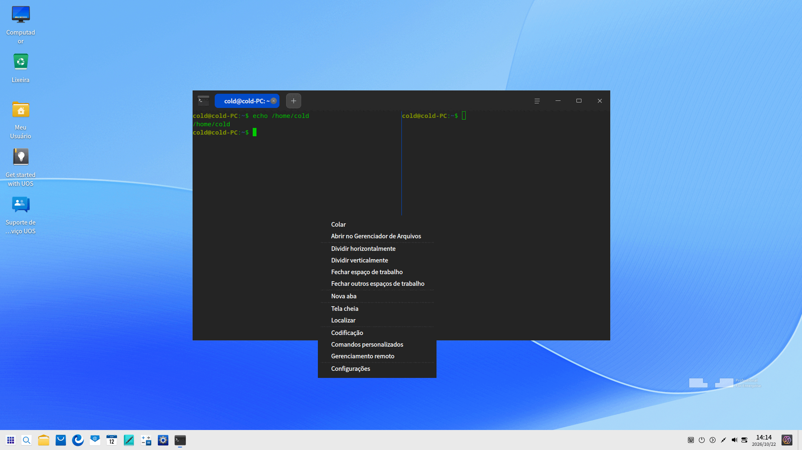

### Ajustar Métodos de Codificação

Quando caracteres ilegíveis ou erros de exibição ocorrerem, você pode alterar a codificação de caracteres para corrigi-los.

1. Na interface do Terminal, clique com o botão direito e selecione **Codificação**.
2. Selecione uma codificação na lista para verificar se o conteúdo é exibido corretamente.
3. Repita o Passo 2 até obter a exibição correta.

>  Notas: Normalmente, a codificação correta é detectada automaticamente pelo Terminal. Caso ocorra alguma anormalidade em circunstâncias especiais, você pode ajustá-la manualmente. Se souber a codificação exata, escolha-a diretamente; caso contrário, experimente as opções da lista.

## Operações de Janela

A janela é a base para suas operações no Terminal. Uma janela é criada ao iniciar o terminal. Você pode criar várias abas em uma janela e dividir uma aba ou janela em múltiplos espaços de trabalho.

### Criar Janelas

Você pode criar uma nova janela das seguintes maneiras:

- Abra o Terminal e clique em  > **Nova janela**.
- Clique com o botão direito em  no Dock e selecione **Nova janela**.

### Exibir Janelas em Tela Cheia

1. Abra o Terminal.
2. Pressione **F11** para exibir o Terminal em tela cheia.
3. Para restaurar o tamanho normal, pressione **F11** novamente.

>  Notas: Você também pode clicar com o botão direito na interface do Terminal e selecionar **Tela cheia** ou **Sair da tela cheia**.

### Dividir Janelas

1. Na interface do Terminal, clique com o botão direito para:

  - Selecionar **Dividir verticalmente** para dividir a tela em colunas esquerda e direita.
  - Selecionar **Dividir horizontalmente** para dividir a tela em linhas superior e inferior.

2. Você pode inserir comandos em cada painel dividido e visualizar os resultados de comandos diferentes simultaneamente.

>  Dicas: Você também pode pressionar **Ctrl** + **Shift** + **J** no teclado para dividir verticalmente e **Ctrl** + **Shift** + **H** para dividir horizontalmente.

 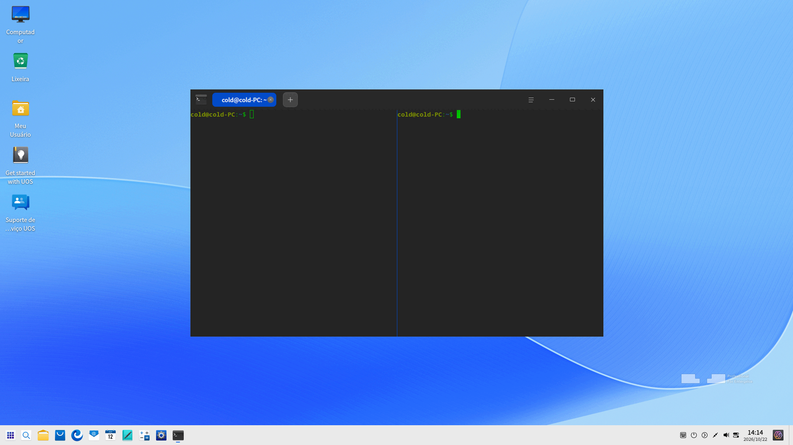

### Fechar Espaços de Trabalho

Você pode fechar divisões de espaço de trabalho seguindo estes passos:

1. Na interface do Terminal, posicione o cursor sobre um dos espaços de trabalho divididos.
2. Clique com o botão direito para:

  - Selecionar **Fechar espaço de trabalho** para fechar este painel dividido.
  - Selecionar **Fechar outros espaços de trabalho** para fechar todos os outros painéis divididos, exceto o atual.

 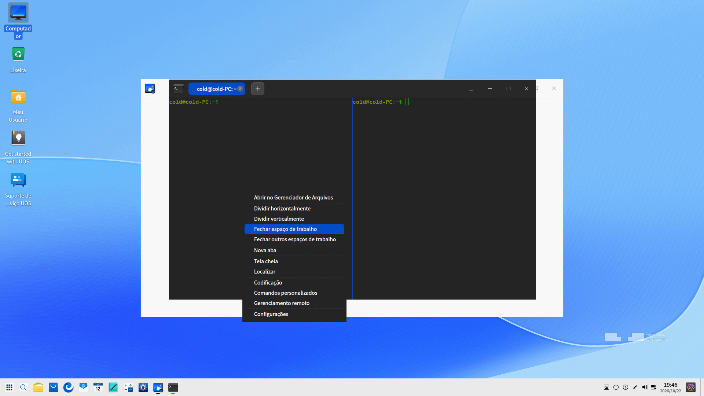

## Operações de Aba

### Criar Abas

Você pode criar novas abas das seguintes maneiras:

- Na interface do Terminal, clique com o botão direito e selecione **Nova aba**.
- Clique no botão  na barra superior para adicionar uma aba.
- Pressione **Ctrl** + **Shift** + **T** no teclado para criar uma nova aba.

### Alternar/Organizar Abas

Você pode alternar livremente entre múltiplas abas pelos seguintes métodos:

- Pressione **Ctrl** + **Tab** ou role a roda do mouse sobre o título da aba para alternar sequencialmente.
- Pressione **Ctrl** + **Shift** + números de **1 a 9** para selecionar a aba correspondente. Quando houver mais de 9 abas, a última será selecionada em vez da nona.
- Arraste uma aba para alterar sua posição na mesma janela.
- Arraste uma aba para fora da janela atual para criar uma nova janela independente.
- Arraste uma aba para fora da janela atual e solte-a dentro de outra janela existente.

### Renomear Abas

1. Na interface do Terminal, clique com o botão direito em uma aba e selecione **Renomear título**.

  - Formato do título da aba: Selecione um formato na lista suspensa **Inserir** e personalize o título da aba atual conforme necessário.
  - Formato do título da aba remota: Selecione um formato na lista suspensa **Inserir** e personalize o título da aba remota conforme desejado.

2. Clique em **Confirmar**.

>  Dicas: Você também pode pressionar **F2** para renomear a janela/aba.

 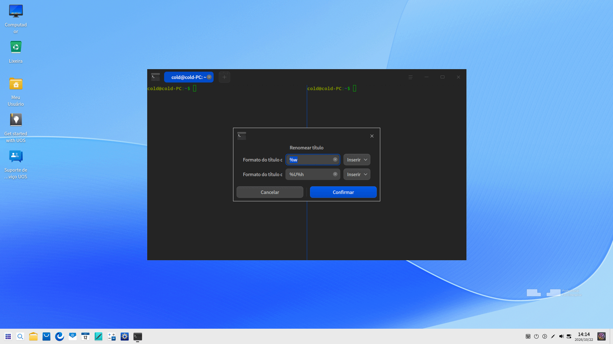

### Fechar Abas

Você pode fechar abas das seguintes formas:

1. Selecione a aba a ser fechada e clique no ícone  na aba.
2. Clique com o botão direito em qualquer aba para:
 - Selecionar **Fechar aba** para fechar a aba selecionada.
 - Selecionar **Fechar as outras abas** para fechar todas as abas, exceto a atual.

>  Dicas: Quando houver apenas uma aba no espaço de trabalho, você também pode clicar com o botão direito e selecionar **Fechar espaço de trabalho** para fechá-la.

## Gerenciamento Remoto

Você pode abrir o painel de gerenciamento remoto para adicionar servidores remotos pelo menu principal ou pelo menu de clique com o botão direito. Após cadastrar um servidor remoto, você poderá conectar-se a ele com apenas um clique.

### Adicionar Servidores

1. Na interface do Terminal, clique em  > **Gerenciamento remoto**.
2. Clique em **Adicionar Servidor** e uma caixa de diálogo será exibida.
3. Preencha **Nome do servidor**, **Endereço**, **Nome de usuário** e **Senha**.
4. Clique em **Adicionar**.

   >   Notas: Se precisar configurar mais parâmetros, clique em **Opções avançadas**. 

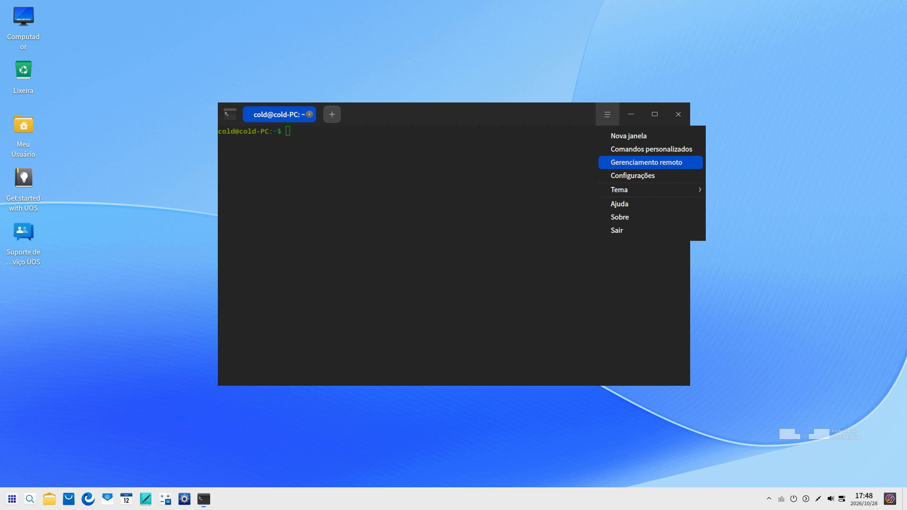

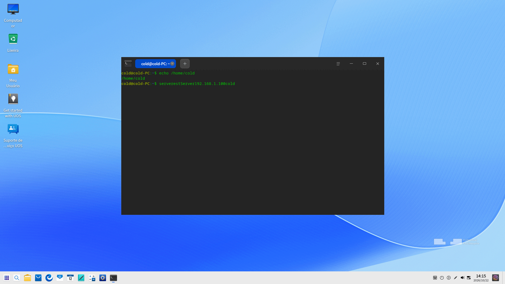 

 

### Editar Servidores

1. Na interface de Gerenciamento Remoto, clique no ícone  no servidor desejado.
2. Edite as informações do servidor conforme necessário.
3. Clique em **Salvar**.

 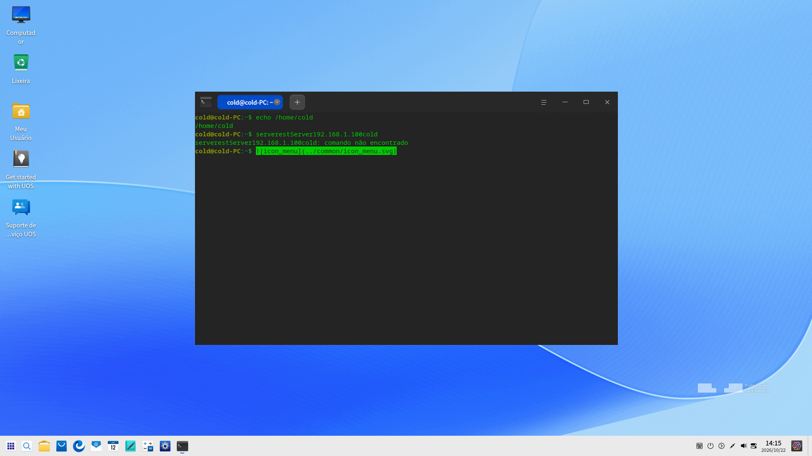

### Agrupar Servidores

Ao definir um grupo para um servidor, ele será organizado no grupo correspondente e exibido no painel de gerenciamento remoto à direita.

1. Na interface do Terminal, clique no ícone **Adicionar Servidor** para abrir a caixa de diálogo ou clique no ícone  ao lado de um servidor existente para abrir a edição.
2. Clique em **Opções avançadas**.
3. Insira as informações do **Grupo**.
4. Clique em **Salvar**.

 

### Pesquisar Servidores

Quando houver múltiplos servidores ou grupos, uma barra de pesquisa será exibida no topo, permitindo buscar rapidamente entre todos os servidores.

1. Na interface do Terminal, clique com o botão direito e selecione **Gerenciamento remoto**.
2. Digite as palavras-chave e pressione **Enter**.
3. Os resultados da pesquisa serão exibidos imediatamente.

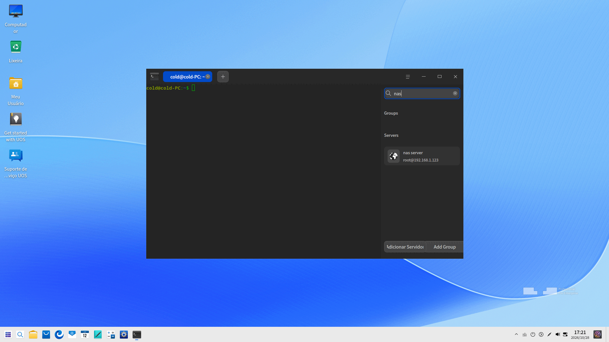

### Carregar/Baixar Arquivos

Você pode enviar (upload) e baixar (download) arquivos após fazer login em um servidor remoto.

#### Enviar Arquivos (Upload)

1. No painel de Gerenciamento Remoto, selecione um servidor para efetuar login.
2. Na interface do Terminal, clique com o botão direito e selecione **Enviar arquivo**.
3. Selecione o arquivo a ser enviado na janela exibida.
4. Clique em **Enviar** e o arquivo será transferido para o servidor remoto.

>  Dicas: Você também pode arrastar o arquivo diretamente para dentro da janela do terminal conectado para fazer o upload.

#### Baixar Arquivos (Download)

1. No painel de Gerenciamento Remoto, selecione um servidor para efetuar login.
2. Na interface do Terminal, clique com o botão direito e selecione **Baixar arquivo**.
3. Selecione o local de armazenamento no computador local.
4. Digite o caminho do arquivo remoto a ser baixado. O arquivo será salvo no local especificado.

### Excluir Servidores

1. Acesse a interface **Editar Servidor**.
2. Clique em **Opções avançadas**.
3. Selecione **Excluir servidor**.
4. Clique em **Excluir** na janela pop-up para confirmar.

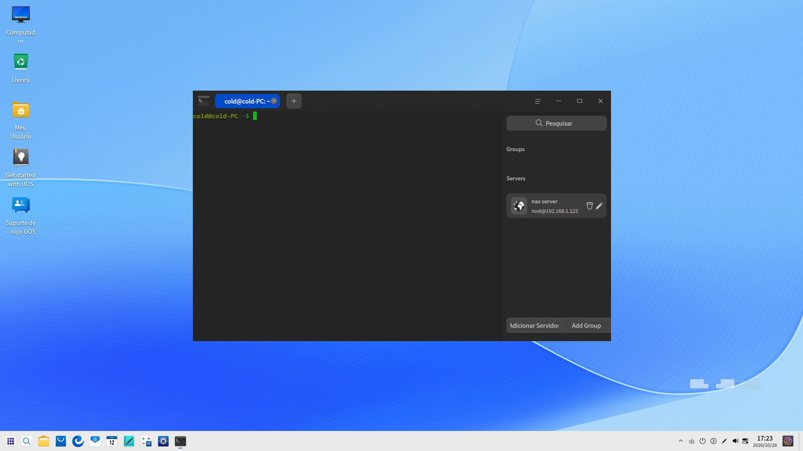

## Menu Principal

No Menu Principal, você pode [Criar Janelas](#criar-janelas), personalizar comandos, acessar o [Gerenciamento Remoto](#gerenciamento-remoto), alternar temas, consultar o manual de ajuda e obter mais informações sobre o Terminal.

### Tema

A interface oferece múltiplos temas visuais.

1. Na interface do Terminal, clique em .
2. Clique em **Tema** e você poderá:

   - Escolher um dos temas integrados do Terminal.
   - Personalizar seu próprio esquema de cores na janela **Tema Personalizado**.

### Comandos Personalizados

1. Na interface do Terminal, clique em .
2. Selecione **Comandos personalizados**.
3. Selecione **Adicionar comando**.
4. Preencha **Nome**, **Comando** e **Atalho**.
5. Clique em **Adicionar**.

### Configurações

#### Configurações Básicas

1. Na interface do Terminal, clique em  > **Configurações**.
2. Na guia **Básico**, você pode:

   - Definir a **Opacidade** do plano de fundo.
   
   > Notas: Se os Efeitos de Janela estiverem desativados no Centro de Controle, a barra de controle de **Opacidade** ficará oculta.

   - Escolher a fonte e o tamanho do texto.
   - Clicar nos botões "+" ou "-" ou rolar a roda do mouse na caixa de tamanho de fonte para ajustar o tamanho do texto.

3. Na guia **Títulos das abas**, você pode configurar o formato de nomeação padrão para todas as abas locais e remotas.

#### Configurações de Atalhos

1. Na interface do Terminal, clique em  > **Configurações**.
2. Na guia **Atalhos**, você pode:

  - Modificar atalhos: Clique no atalho desejado e pressione a nova combinação de teclas no teclado.
  - Desativar atalhos: Clique no atalho que deseja desativar e pressione **Backspace** no teclado para desabilitá-lo.

#### Configurações Avançadas

1. Na interface do Terminal, clique em  > **Configurações**.
2. Na guia **Avançado**, você pode:

  - Definir o **Estilo do cursor**.
  - Ativar ou desativar o **Cursor piscante**.
  - Ativar ou desativar **Copiar ao selecionar**.
  - Ativar ou desativar **Rolar ao pressionar tecla**.
  - Ativar ou desativar **Rolar na saída**.
  - Definir o modo de inicialização da janela.
  - Ativar ou desativar **Desfocar o fundo**.
   > Notas: Se os Efeitos de Janela estiverem desativados no Centro de Controle, a opção **Desfocar o fundo** ficará oculta.

  - Ativar ou desativar **Ocultar a janela Quake após perder o foco**.
  - Selecionar o **Perfil do shell**.
  - Ativar ou desativar o controle de fluxo via **Ctrl** + **S** e **Ctrl** + **Q**.

### Ajuda

1. Na interface do Terminal, clique em .
2. Clique em **Ajuda** para visualizar o manual do Terminal.

### Sobre

1. Na interface do Terminal, clique em .
2. Clique em **Sobre** para visualizar a versão e a apresentação do Terminal.

### Sair

1. Na interface do Terminal, clique em .
2. Clique em **Sair** para fechar o Terminal.